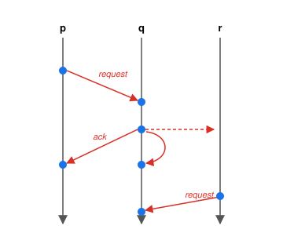

## Setup

Requires Python 3.10 or newer (developed and tested on 3.13).

Run `./setup.sh` to create the virtual environment and install the project.
It performs an editable install (`pip install --editable . --group dev`), so
`import spacetime` resolves to this checkout and the `spacetime` command is
available inside `.venv/bin/`. Dependencies live in `pyproject.toml`.

The environment lives **only** in `.venv/`. Do not create one in place at the
repository root (`python3 -m venv .`): `setup.sh` refuses to run in that
situation, and the stray `bin/`, `lib/`, `include/` and `pyvenv.cfg` would
shadow the real environment.

## Running

Compile a DSL file and print the refined AST:

```bash
source .venv/bin/activate
spacetime example.txt        # equivalently: python -m spacetime example.txt
```

To inspect every compiler stage, add `--print-stages`. It prints the Lark
parse tree, the intermediate `Ast`, and the refined AST, each under a header:

```bash
spacetime --print-stages example.txt
```

Run the test suite:

```bash
source .venv/bin/activate
pytest -q
```

## Specification

- [`spacetime/grammar.lark`](spacetime/grammar.lark) — the entire
  specification: the concrete syntax, plus the semantic rules documented
  as an attribute grammar in comments.
- [`docs/qualidade.md`](docs/qualidade.md) — language and grammar quality
  evaluation (TP1, task 4), with metrics from `docs/metricas_gramatica.py`.

## Linguagem para escrever lamport space-time diagrams

Example:
```
Processes {
  p
  q
  r
}

Messages {
  request := "Request o que quiser"
  ack := "Ack"
  vote := "Votes for leader"
}

History {
  m1 := Send(request) :: p -> q
  Recv(m1) :: q

  m2 := Send(ack) :: q -> p, q, r
  Recv(m2) :: p, q

  m3 := Send(request) :: r -> q
  Recv(m3) :: q
}
```


Results in:


