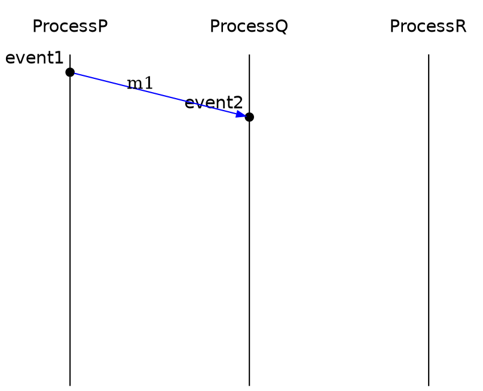
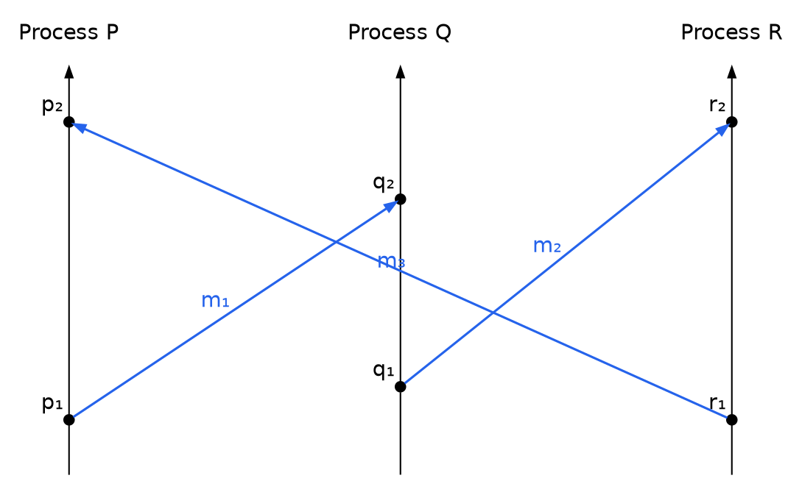

## Setup

Requires Python 3.10 or newer (developed and tested on 3.13).

Run `./setup.sh` to create the virtual environment and install the project.
It performs an editable install (`pip install --editable . --group dev`), so
`import spacetime` resolves to this checkout and the `spacetime` command is
available inside `.venv/bin/`. Dependencies live in `pyproject.toml`.

The environment lives **only** in `.venv/`. Do not create one in place at the
repository root (`python3 -m venv .`): `setup.sh` refuses to run in that
situation, and the stray `bin/`, `lib/`, `include/` and `pyvenv.cfg` would
shadow the real environment.

## Running

Compile a DSL file and print the refined AST:

```bash
source .venv/bin/activate
spacetime example.txt        # equivalently: python -m spacetime example.txt
```

To inspect every compiler stage, add `--print-stages`. It prints the Lark
parse tree, the intermediate `Ast`, and the refined AST, each under a header:

```bash
spacetime --print-stages example.txt
```

Run the test suite:

```bash
source .venv/bin/activate
pytest -q
```

## Linguagem para escrever lamport space-time diagrams

Example of the DSL at `example.txt`

Resulta em:





